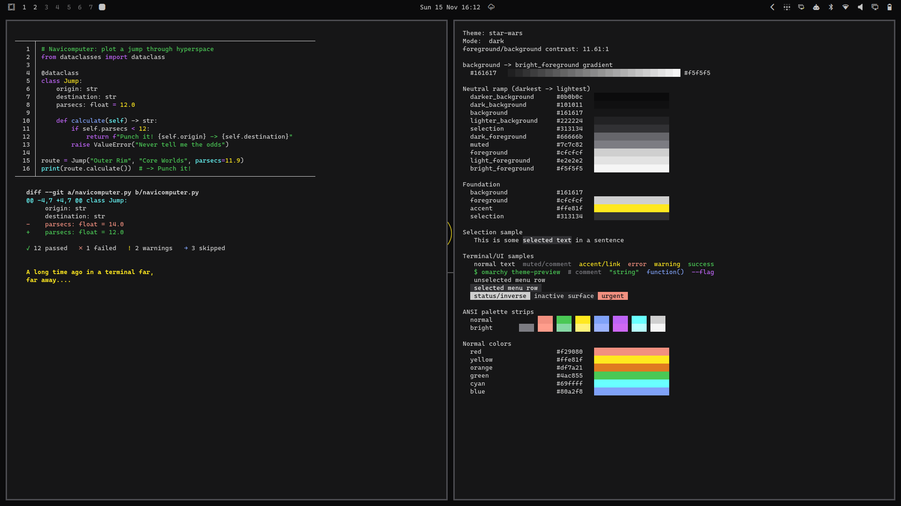
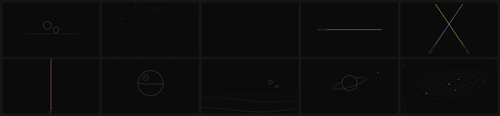
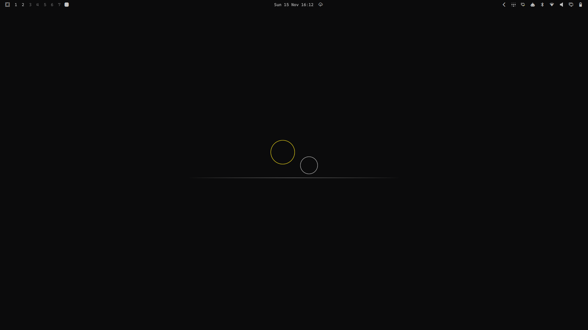
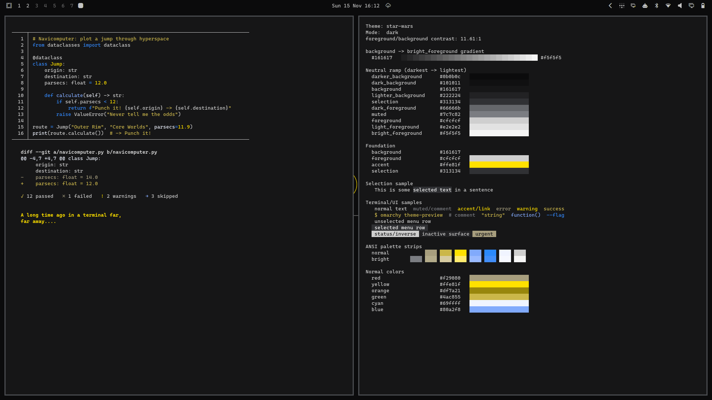

# Star Wars for Omarchy

A quiet, dark Star Wars theme for [Omarchy](https://omarchy.org): near-black
greys, grey text, and opening-crawl yellow as the one accent. The colours are
chosen for protanopia, and the wallpapers are hairline drawings that leave
almost the whole screen dark, each with a short intro animation.



## Install

```bash
omarchy theme install https://github.com/avinashjoshi/omarchy-star-wars-theme
```

Or pick **Star Wars** later from `omarchy theme switcher`.

## What's in it

**Palette** (`colors.toml`), which Omarchy turns into matching configs for
Hyprland, the terminals, btop, Neovim, VS Code, Chromium and the rest:

| Role | Colour | |
|---|---|---|
| Background | `#161617` | near-black, not pitch black, so panels and borders still read |
| Foreground | `#cfcfcf` | soft grey |
| Accent | `#ffe81f` | opening-crawl yellow |
| Blue | `#80a2f8` | saber blue, used for hover and focus |
| Borders | `#55555a` | visible on every surface |

The focused window gets a solid yellow border; the others get plain grey.

**Shell surfaces** (`shell.*.toml`): a dark bar with grey type, dark popups,
menus and notifications with a clear grey edge, yellow for the selected row
and for anything asking for attention.

**T3 Code** (`t3code.json`): neutral grey surfaces and input borders instead
of the accent-tinted ones T3 Code derives by default.

**Backgrounds**: ten original, generated drawings on the theme's darkest
grey. The share of pixels that carry any drawing at all:

| | Drawn pixels |
|---|---|
| *Twin Suns* | 0.105% |
| *Lightspeed* | 0.319% |
| *Starfield* | 0.006% |
| *Saber* | 0.242% |
| *Crossed Blades* | 0.465% |
| *Dark Side* | 0.247% |
| *No Moon* | 0.123% |
| *Dune Sea* | 0.488% |
| *Ringed Planet* | 0.126% |
| *Star Chart* | 0.367% |





**Intros** (`backgrounds/intros/`): each still has a three-second clip of the
drawing assembling itself. The suns rise over the horizon, the blades ignite,
the stars stretch into streaks. Omarchy plays it when you switch to the theme
or boot into it, then leaves the still. Turn them off with
`omarchy theme bg intro disable`.

**Video wallpapers**: *Lightspeed Live* (an 8-second loop of streaks flying
past) and *Starfield Live* (12 seconds of twinkling stars), both as sparse as
the stills.

**Icons**: `Yaru-yellow-dark`.

**Boot splash** (`unlock.png`): the twin suns, used if you run
`omarchy plymouth set by theme star-wars`.

## Real Star Wars art

Film stills and official artwork belong to Lucasfilm, so none are in this
repo. StarWars.com offers its own backgrounds to download, though:

- [Star Wars backgrounds on StarWars.com](https://www.starwars.com/news/star-wars-backgrounds)
  (1920x1080; the starfield, hyperspace and Star Destroyer interiors suit this
  theme best)

Save the ones you like into `~/.config/omarchy/backgrounds/star-wars/` and
they join this theme's wallpaper rotation on your machine only
(`omarchy theme bg install` opens that folder).

## Built for protanopia

Protanopia removes the red-sensing cones. Red light looks dim, and red, orange
and green collapse toward the same yellow-brown, while blue against yellow
stays as clear as ever. So the theme is built on that axis:

- **States swing between blue and yellow or orange, never red and green.**
  Hover and focus are blue, selection is yellow, and a wrong password on the
  lock screen or a sudo prompt turns orange.
- **Red is a light coral** (`#f29080`), not a saturated red, which a protanope
  sees as a dark brown that sinks into the background.
- **Red and green differ in brightness as well as hue**, so a diff still reads
  when the hue difference is gone.
- **Purple is kept darker than blue**, because without red the two share a hue.
- **The one red blade** (*Dark Side*) keeps a white core, and its glow is a
  red light enough to hold 4.7:1 on the wallpaper under the simulation.

`.art/cvd.py` simulates protanopia (Machado, Oliveira & Fernandes 2009, full
severity) and measures two things on the simulated colours: contrast against
the background, and how far apart the meaningful colours stay. For this
palette:

| Colour | Hex | As a protanope sees it | Contrast on background |
|---|---|---|---|
| Foreground | `#cfcfcf` | `#cfcfcf` | 11.6:1 |
| Red | `#f29080` | `#a79e7e` | 6.7:1 |
| Orange | `#df7a21` | `#98860c` | 5.0:1 |
| Yellow | `#ffe81f` | `#ffe100` | 13.8:1 |
| Green | `#4ac855` | `#cbb749` | 8.9:1 |
| Cyan | `#69ffff` | `#f0f4ff` | 16.4:1 |
| Blue | `#80a2f8` | `#81aafc` | 7.8:1 |
| Magenta | `#be64f6` | `#2b89fb` | 5.2:1 |

Every pair among those colours, the comment grey and the text stays at least
0.113 apart in OKLab under the simulation (the bright set, 0.106), where about
0.02 is one just-noticeable step. Comment grey (`#7c7c82`) is deliberately
quieter at 4.4:1.

The preview above, run through the same simulation:



This is a simulation, not a substitute for your own eyes. If two colours are
hard to tell apart for you, please open an issue.

## Regenerating

```bash
uv run --with numpy .art/cvd.py              # palette report
uv run --with numpy .art/cvd.py --search     # search for a better set of hues
uv run --with numpy --with pillow .art/generate.py stills    # wallpapers
uv run --with numpy --with pillow .art/generate.py videos    # intros and loops (needs ffmpeg, takes ~10 minutes)
uv run --with numpy --with pillow .art/generate.py emblem unlock-preview contact-sheet
```

## License

MIT, see [LICENSE](LICENSE). This is an unofficial fan theme. Star Wars is a
trademark of Lucasfilm Ltd.; this project is not affiliated with or endorsed
by Lucasfilm or Disney. All artwork here is original line art, drawn by the
script in `.art/`; no film images or logos are included.
